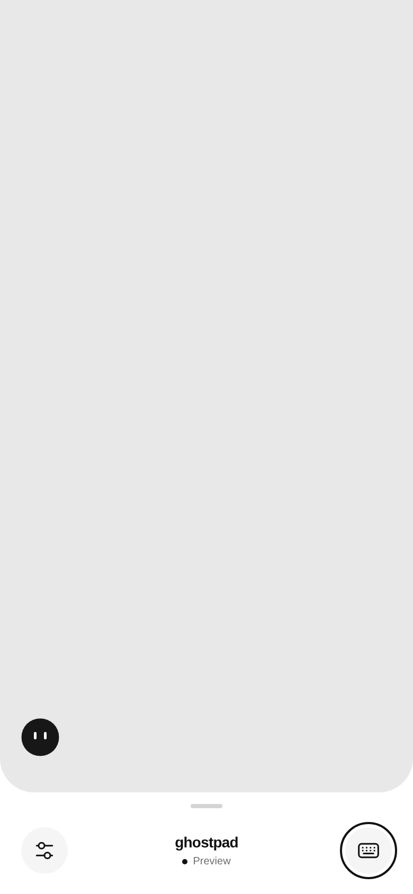

# Ghostpad

**Click from the couch**

Turn your phone into a wireless trackpad and keyboard for your Linux computer. Scan a QR code, open the link in your phone's browser, and slide to move. No phone app, account, cloud service, or telemetry.

Ghostpad is an early release. It supports Linux receivers and Safari on iPhone / Chrome on Android. Windows and macOS receivers are not implemented. Native pinch depends on your Linux compositor and application; typing currently requires a US keyboard layout with Caps Lock off and supports ASCII text.

**Use trusted private Wi-Fi. The default HTTP connection is not encrypted.** Someone who intercepts it can obtain control of your computer. Keep pairing codes private, never forward the port to the internet, and read [Security](SECURITY.md) before using Ghostpad on a shared network.



## Install

You need Linux, Rust **1.85+**, a C linker, OpenSSL development libraries, Make, and Python **3.9+**. Node is only needed for frontend development. The receiver has no Cargo registry dependencies, and its phone interface is built into the executable.

Install [your distribution's prerequisites](docs/installation.md#build-from-source), then:

```sh
git clone https://github.com/dmesgus/ghostpad.git
cd ghostpad
make install
make setup-persistent
```

`make install` installs for your user under `~/.local`; run it **without sudo**. The separate setup command asks for sudo to load Linux's input module and allow the active local desktop session to create virtual input devices. For access lasting only until reboot, use `make setup` instead.

Open **Ghostpad** from your app launcher, or run:

```sh
~/.local/bin/ghostpad --desktop
```

When binary releases are available, you can [install an archive without Rust or Node](docs/installation.md#install-a-release-archive). Updates use the same installer, and `make uninstall` removes installed files while keeping saved pairing.

## Connect your phone

1. Put your phone and computer on the same trusted Wi-Fi.
2. Open Ghostpad on the computer and scan its QR code. Use Safari on iPhone or Chrome on Android. If a scanner opens a preview, choose **Open in browser**.
3. Keep the phone page open and the phone unlocked. Slide one finger to move; tap to click.

You can also use **Copy pairing link**. Install `qrencode` on the computer to display QR codes. Reopen the saved phone link to reconnect. If another phone has control, tap **Use this phone** to switch.

If your firewall blocks the phone, allow that phone's Wi-Fi IPv4 address explicitly:

```sh
~/.local/bin/ghostpad-allow-phone PHONE_WIFI_IPV4 --dry-run
~/.local/bin/ghostpad-allow-phone PHONE_WIFI_IPV4
```

This helper supports UFW and asks for sudo. The desktop help also offers a rule scoped to a trusted interface and subnet for using multiple phones or changing IPs. For other firewalls, allow inbound TCP **8765** from your phone on the private interface. See [network troubleshooting](docs/troubleshooting.md).

Closing the computer's pairing tab leaves Ghostpad running. Open Ghostpad again to return to that page; choose **Stop Ghostpad** to exit. A receiver started in a terminal also stops with Ctrl+C. Installing Ghostpad does not enable an automatic background service.

## Gestures

| Action | Gesture |
| --- | --- |
| Move / click / double-click | Slide / tap / tap twice with one finger |
| Right-click | Tap two fingers or the bottom-right corner |
| Scroll | Slide two fingers, or use the side strip |
| Zoom | Pinch two fingers; needs native touchpad gesture support |
| Drag or select | Tap, then quickly touch again and slide; lift to release |
| Hold Super | Hold the bottom-left corner; lift to release |
| Type or send shortcuts | Open the keyboard from the bottom dock |
| Adjust speed, scrolling, or appearance | Open Settings |

See the [usage guide](docs/usage.md) for keyboard shortcuts, window gestures, and pairing revocation.

## Useful commands

```sh
make doctor                       # Read-only diagnostics; no secrets
make preview                      # Try pairing with computer input disabled
make run ARGS="--address 192.168.1.42"
make uninstall                    # Remove this user's installed app
make help                         # All build, test, and packaging commands
```

The installed diagnostic command is `~/.local/bin/ghostpad-doctor`. When running from source, `make run` and `make preview` open your browser. For a terminal QR, run `./target/release/ghostpad` directly. Use `ghostpad --help` for address, port, TLS, and logging options.

## Documentation

- [Installation, updating, and complete removal](docs/installation.md)
- [Using Ghostpad](docs/usage.md)
- [Connection and input troubleshooting](docs/troubleshooting.md)
- [Security model, HTTPS, and private vulnerability reporting](SECURITY.md)
- [Development and contributing](CONTRIBUTING.md)
- [Architecture](docs/architecture.md), [wire protocol](PROTOCOL.md), and [UI implementation](UI.md)
- [Changelog](CHANGELOG.md) and [maintainer release checklist](docs/releasing.md)

## Project status

Automated tests cover the receiver, TCP/TLS pairing, input release, browser controls, and Android/iPhone Chromium profiles. Browser emulation does not verify real Safari or native compositor behavior. Physical iPhone/Android and Linux desktop testing remains a release requirement; there are no measured real-Wi-Fi latency or battery guarantees.

Next priorities are real-device validation, per-device pairing and revocation, and easier trusted HTTPS. Additional operating systems and a tray can follow once the Linux experience is dependable.

MIT licensed; see [LICENSE](LICENSE). Inspired by [NomadPadServer](https://github.com/r1cA18/NomadPadServer). Ghostpad is an independent implementation with its own protocol and does not work with the NomadPad iOS app.
